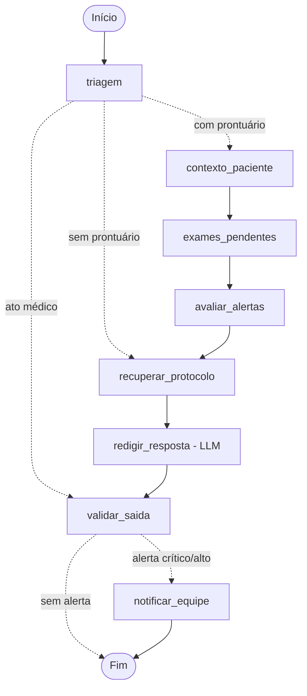

# Relatório Técnico — Tech Challenge Fase 3

**Assistente médico virtual com LLM customizada, LangChain e LangGraph**
FIAP Postech — IA para Devs | Hospital Santa Helena (fictício) | 2026

---

## 1. Introdução e contexto

A Fase 1 entregou um classificador de câncer de mama sobre o dataset Wisconsin. A
Fase 2 otimizou seus hiperparâmetros por algoritmo genético e trouxe um **LLM
local** para traduzir o diagnóstico em linguagem clínica. Nesta fase o LLM muda
de papel: deixa de ser intérprete de um resultado e passa a ser **assistente do
corpo clínico** — treinado com os protocolos do hospital, consultando prontuários,
verificando pendências de exame e emitindo alertas para a equipe.

O enunciado pede quatro coisas: fine-tuning com dados médicos internos, um
assistente com LangChain que consulte base estruturada, segurança e validação
(limites de atuação, logging, explicabilidade) e código modularizado. Este
relatório descreve como cada uma foi resolvida e, onde houve trade-off, qual
alternativa foi descartada e por quê.

**Premissa que atravessa o projeto:** num assistente clínico, o LLM deve ser a
parte *substituível* do sistema. Tudo que precisa de garantia — limite de atuação,
pendência de exame, alerta, citação de fonte, auditoria — está em código
determinístico. O modelo redige; ele não decide o que é verdade sobre o paciente.

### Ambiente e restrições reais

| Recurso | Situação |
|---|---|
| GPU | nenhuma com CUDA (Intel Arc integrada) |
| RAM / CPU | 30 GB / 8 núcleos |
| Servidor de inferência | `llama.cpp` (`llama-server`), herdado da Fase 2 |
| Modelo servido na Fase 2 | Qwen3 4B Instruct, GGUF Q4_K_M |

Essas restrições decidiram escolhas concretas descritas na seção 4 — e estão
registradas aqui porque um relatório que apresenta apenas o caminho ideal esconde
justamente a parte que exigiu engenharia.

---

## 2. Os dados internos do hospital

### 2.1 O que foi gerado

O enunciado pede protocolos médicos, perguntas frequentes de médicos e modelos de
laudos, receitas e procedimentos. Os três foram construídos como corpus sintético
autoral, determinístico (semente fixa):

| Fonte | Volume | Papel |
|---|---|---|
| Protocolos internos | 8 documentos, 40 seções | conteúdo clínico e base de recuperação |
| FAQ do corpo clínico | 38 itens | registro de pergunta e resposta de plantão |
| Modelos de documento | 72 (laudo, receita, procedimento) | formato institucional |
| Prontuários | 24 pacientes | base estruturada consultável |
| MedQuAD (externo) | ~200 pares | conhecimento médico geral |

Os protocolos cobrem oito especialidades — oncologia mamária (continuidade das
fases anteriores), sepse, síndrome coronariana, cetoacidose diabética, AVC,
pneumonia, tromboembolismo e stewardship de antimicrobianos. Cada um traz código,
versão, data de revisão, indicação, critérios, conduta, exames obrigatórios e
alertas de não conformidade.

Uma decisão estrutural que compensou: **os exames dos pacientes são um subconjunto
dos exames obrigatórios do protocolo aplicável**. Isso torna "exame pendente" uma
diferença de conjuntos verificável, e não uma resposta que dependa do modelo.

### 2.2 Anonimização

O corpus bruto (`data/raw/`) é gerado **com** PII: nomes, CPFs, CNS, RGs,
prontuários, telefones, e-mails, endereços e CEPs. Isso é deliberado — sem PII na
entrada não há como demonstrar nem testar o pipeline exigido pelo desafio.

A técnica escolhida foi **pseudonimização determinística** (HMAC-SHA256 com sal):

```
Paciente Maria Aparecida Souza, CPF 123.456.789-00, tel (11) 98765-4321
        ↓
Paciente [NOME_B9FC], CPF [CPF_19FF], tel [TELEFONE_6940]
```

O mesmo valor sempre gera o mesmo token. A alternativa óbvia — remover ou
substituir por um marcador genérico (`[NOME]`) — foi descartada porque destrói a
coerência referencial: o modelo deixaria de aprender que um documento fala de uma
única pessoa, e um texto com três `[NOME]` diferentes viraria ambíguo. A
pseudonimização preserva a estrutura do texto sem preservar o dado.

Foram **260 identificadores removidos** em 372 passagens processadas, distribuídos
em 10 tipos. O relatório completo está em
`results/eval/relatorio_anonimizacao.json`.

Dois cuidados no detector, ambos com teste dedicado:

- **Não confundir clínica com identificador.** `30 mL/kg`, `0,1 U/kg/h`,
  `PAM 65 mmHg` e `lactato 2 mmol/L` passam intactos. Um detector agressivo
  demais destruiria a informação que o assistente precisa dar.
- **Preservar o título.** `Dra. Helena Prado` vira `Dra. [NOME_5900]` — o registro
  continua legível como texto clínico.

### 2.3 Curadoria

Se a anonimização decide o que *pode* entrar, a curadoria decide o que *deveria*:

| Filtro | Critério | Descartes |
|---|---|---|
| Tamanho | pergunta ≥ 12 caracteres; resposta entre 60 e 2000 | 0 |
| PII residual | qualquer identificador sobrevivente | 0 |
| Citação de fonte | exemplo interno precisa referenciar `PROT-XXX-000` | 0 |
| Duplicata exata | hash da pergunta normalizada | 3 |
| Quase-duplicata | Jaccard ≥ 0,85 sobre shingles de 5 palavras | 0 |

O filtro de citação de fonte é o mais interessante dos cinco: ele faz a
explicabilidade entrar **já no treino**. Um exemplo cuja resposta não cita
protocolo não vira dado de treino, então o modelo nunca observa uma resposta
interna sem fonte. É mais barato e mais confiável do que tentar corrigir isso
depois no prompt.

O gate de PII e o de citação não descartaram nada na execução final — o que é o
resultado esperado quando o pipeline anterior funcionou. Eles existem como
**detector de regressão**: se alguém alterar o gerador ou o anonimizador e algo
vazar, o número deixa de ser zero e o teste falha.

### 2.4 Dataset final

389 exemplos brutos → 386 aprovados → **328 de treino e 58 de validação**, com
split estratificado por categoria:

| Categoria | Exemplos | O que ensina |
|---|---|---|
| `protocolo_qa` | 120 | conteúdo dos protocolos, seção a seção, com fonte |
| `conhecimento_geral` | 195 | registro de resposta clínica geral (MedQuAD, inglês) |
| `documento` | 24 | formato dos modelos institucionais |
| `faq` | 20 | dúvidas de plantão ancoradas em protocolo |
| `faq_contextualizada` | 12 | a mesma dúvida aplicada a um caso concreto |
| `limite_de_atuacao` | 15 | recusa de ato médico, com alternativa oferecida |

Sobre o MedQuAD: os pares foram mantidos **em inglês**, com instrução de sistema
própria. Traduzir automaticamente conteúdo clínico introduz erro terminológico
exatamente onde ele custa mais caro, e não havia tradutor humano disponível para
revisar 200 pares. Marcá-los como conhecimento geral em inglês é a leitura
honesta do que eles são.

---

## 3. O assistente médico

### 3.1 Fluxo de decisão (LangGraph)

O fluxo tem oito nós e três arestas condicionais:



| Nó | Determinístico? | Garantia que oferece |
|---|---|---|
| `triagem` | sim | pedido de ato médico não chega ao modelo |
| `contexto_paciente` | sim | apenas o contexto clínico mínimo é exposto |
| `exames_pendentes` | sim | pendência é diferença de conjuntos |
| `avaliar_alertas` | sim | alerta nasce de regra sobre dado estruturado |
| `recuperar_protocolo` | sim | citação por seção, com score |
| `redigir_resposta` | **não** | único ponto de geração |
| `validar_saida` | sim | sem PII cadastral, com fonte, com aviso |
| `notificar_equipe` | sim | alerta crítico vira notificação registrada |

**Sete dos oito nós são código.** Essa proporção é a tese do projeto: o LLM entra
depois que o sistema já sabe qual é o paciente, o que falta, o que está errado e
qual protocolo se aplica. Ele redige com esse material.

### 3.2 Consulta à base estruturada

Os prontuários vivem em SQLite (`data/structured/prontuarios.db`), com tabelas de
pacientes, exames e medicações. O acesso é exposto ao LangChain como ferramentas
(`consultar_prontuario`, `verificar_exames_pendentes`, `avaliar_alertas`,
`consultar_protocolo`) e chamado diretamente pelos nós do grafo — mesmas funções,
dois caminhos.

O ponto de projeto está no que **sai** dali. O banco guarda o cadastro completo;
`clinical_context()` devolve apenas idade, sexo, setor, leito, queixa, condição,
protocolo, comorbidades, alergias, sinais vitais, escores, exames e medicações.
CPF, CNS, RG, nascimento, telefone, e-mail e endereço nunca entram no prompt.
Um teste falha se qualquer campo identificável vazar.

### 3.3 Recuperação de protocolo

Indexamos **seções**, não arquivos: a citação precisa ter a granularidade de
"PROT-EME-002 v6.0, seção 3 — Conduta". A busca é BM25 implementado no projeto,
sem dependência externa.

A escolha de busca léxica sobre embeddings foi deliberada. São 8 protocolos com
vocabulário técnico estável e códigos (`PROT-EME-002`) que precisam casar
literalmente; BM25 acerta esse caso, responde em milissegundos sem carregar um
modelo de embedding e — o que mais pesou — é auditável: dá para mostrar ao médico
o score e os termos que casaram. Com um corpus maior e consultas mais
parafrásticas a conclusão mudaria, e a troca está isolada atrás de
`ProtocolRetriever.search`.

Um ajuste que só apareceu na execução: a seção de *Referências bibliográficas*
pontuava alto por ser curta (a normalização por tamanho do BM25 favorece
documentos curtos) e aparecia entre os três primeiros resultados sem responder
nada. Ela saiu do índice.

### 3.4 Alertas para a equipe médica

São 11 regras determinísticas sobre o prontuário, cada uma com severidade e o
protocolo que a fundamenta. Exemplos:

| Alerta | Regra | Severidade |
|---|---|---|
| `SEPSE_HEMOCULTURA_APOS_ATB` | antimicrobiano ativo com hemocultura pendente | crítico |
| `CAD_INSULINA_COM_HIPOCALEMIA` | insulina em curso com K < 3,3 mEq/L | crítico |
| `AVC_JANELA_ATIVA` | início dos sintomas < 4,5 h, com tempo restante calculado | crítico |
| `ALERGIA_X_PRESCRICAO` | medicação ativa da mesma classe de alergia registrada | crítico |
| `TEV_SEM_PROFILAXIA` | escore de Pádua ≥ 4 sem profilaxia registrada | alto |
| `EXAME_OBRIGATORIO_NAO_SOLICITADO` | rol do protocolo sem solicitação | alto |

Alerta é o tipo de saída em que alucinação custa nos dois sentidos: um alerta
inventado vira ruído e treina a equipe a ignorar; um omitido vira dano. Por isso
nenhum deles passa pelo modelo — o LLM redige o caso, mas quem decide que há
alerta é a regra.

---

## 4. Fine-tuning

*(Seção completada com os resultados da execução — ver §4.4 e §5.)*

### 4.1 Escolha do modelo base

A intenção inicial era treinar o próprio Qwen3 4B que a Fase 2 já servia. Duas
restrições impediram:

1. **GGUF quantizado não é treinável.** Pesos em 4 bits são formato de
   inferência; gradiente exige os pesos originais em ponto flutuante.
2. **Sem GPU CUDA.** LoRA num modelo de 4B em 8 núcleos de CPU levaria muitas
   horas por época — inviável para iterar.

A solução preserva a continuidade sem fingir capacidade inexistente: treinar um
**Qwen menor da mesma família** — mesmo chat template, mesmo tokenizer — e servir
o resultado **no mesmo `llama-server`**. O que muda entre as fases é o modelo
servido, não a infraestrutura de inferência.

| Cenário | Modelo | Onde |
|---|---|---|
| Desenvolvimento e demonstração | `Qwen2.5-0.5B-Instruct` | CPU local |
| Maior capacidade | `Qwen2.5-1.5B-Instruct` | Colab T4 (`--device cuda`) |

### 4.2 LoRA e hiperparâmetros

| Parâmetro | Valor |
|---|---|
| `r` / `alpha` / `dropout` | 16 / 32 / 0,05 |
| Módulos-alvo | `q,k,v,o,gate,up,down_proj` |
| Learning rate | 2e-4, warmup 6%, cosine decay |
| Épocas | 2 |
| Batch efetivo | 8 (1 × 8 de acumulação) |
| `max_len` | 1024 tokens |

**Parâmetros treináveis: 8.798.208 de 502.830.976 (1,75%).**

Fine-tuning completo foi descartado por três razões práticas: não caberia em CPU,
não traria ganho perceptível para um dataset de 328 exemplos, e produziria um
artefato de 1 GB onde o LoRA produz alguns MB — o que torna versionar, comparar e
reverter trivial.

### 4.3 Dois detalhes que definem a qualidade do treino

**Chat template do próprio modelo.** As mensagens são renderizadas com
`tokenizer.apply_chat_template`, então o formato de treino é idêntico ao que o
servidor usa na inferência. Divergência aí é a causa mais comum de "treinei e
piorou".

**Loss apenas sobre a resposta.** Os tokens do system e do turno do usuário
recebem label `-100`:

```python
labels = [IGNORE_INDEX] * len(tokens_do_prompt) + tokens_da_resposta
```

Sem essa máscara, o system prompt — longo e repetido em todos os 328 exemplos —
dominaria o sinal de treino, e o modelo gastaria capacidade decorando o próprio
enunciado. O teste `test_loss_so_incide_sobre_a_resposta` verifica que os tokens
supervisionados correspondem exatamente ao sufixo da sequência.

O laço de treino é explícito (AdamW + warmup + cosine + clipping) em vez do
`Trainer` da `transformers`: são ~60 linhas, o comportamento fica visível e não há
dependência de mudanças de API entre versões da biblioteca.

### 4.4 O que o treino ensina — e o que deliberadamente não ensina

O objetivo é **forma**: registro clínico em português, formato dos documentos
institucionais, citação obrigatória da fonte e recusa de ato médico. Conteúdo de
protocolo entra por recuperação, em tempo de consulta.

A razão é operacional, não teórica. Protocolo é documento vivo: a versão 6.0 do
bundle de sepse vira 6.1 no mês seguinte, e um modelo treinado com a versão antiga
continuaria repetindo a antiga com toda a confiança do mundo — e sem que ninguém
percebesse, porque a resposta *parece* correta. Trocar o arquivo em
`data/processed/protocolos/` corrige a resposta na hora, sem retreino.

---

## 5. Segurança e validação

### 5.1 Limites de atuação, em três camadas

O assistente nunca prescreve, não indica dose para administração direta, não
assina laudo ou atestado, não decide alta e não fecha diagnóstico. A garantia
está distribuída:

| Camada | Mecanismo | Papel |
|---|---|---|
| Treino | 15 exemplos de recusa, cada um oferecendo a alternativa cabível | inclina o comportamento |
| Entrada | padrões determinísticos que barram antes da chamada ao modelo | **garante** |
| Saída | reescrita de tom imperativo, bloqueio de PII, inserção do aviso | rede de proteção |

A segunda camada é a que garante, e a razão é direta: fine-tuning altera a
distribuição de saída, não a torna impossível. Uma recusa que depende do decoding
é uma recusa que às vezes não acontece — e "às vezes" é inaceitável quando o
custo é uma prescrição sem médico. O bloqueio na entrada também elimina a
inferência inteira: o pedido nem chega ao modelo, o que aparece na trilha como
ausência do evento `resposta_gerada`.

Os padrões miram o **ato pedido**, não o assunto. "Qual a conduta do PROT-EME-002
na sepse?" passa; "prescreva o antibiótico agora" é barrado. A distinção é testada
nos dois sentidos, porque um guardrail que bloqueia dúvida clínica legítima
destrói a ferramenta com a mesma eficiência com que um guardrail ausente destrói
a segurança.

### 5.2 Uma correção que veio de um teste

O guardrail de saída começou bloqueando qualquer identificador reconhecido. Na
primeira execução do fluxo completo ele bloqueou uma resposta correta: o texto
citava `Prontuário PRT-2026-100137` e a data de admissão.

O ajuste separou duas categorias:

- **Cadastral** (CPF, CNS, RG, nome, telefone, e-mail, endereço, CEP): bloqueia a
  resposta. Nada disso é necessário para decidir conduta.
- **Operacional** (número do prontuário, CRM, datas assistenciais): circula na
  resposta ao profissional, com acesso registrado na trilha. Sem o número do
  prontuário, o médico não sabe de qual caso o assistente está falando.

O dataset de treino continua usando a régua mais rígida — **nenhuma** das duas
categorias entra ali. É a distinção entre o que não pode ficar gravado nos pesos
de um modelo e o que precisa circular numa tela de plantão.

### 5.3 Logging e trilha de auditoria

Duas saídas com propósitos distintos: um log de aplicação legível
(`results/logs/med_assist.log`) e uma trilha estruturada append-only em JSONL
(`results/logs/auditoria.jsonl`). Cada interação recebe um `trace_id` que
atravessa todos os nós:

```
interacao_iniciada     usuario, paciente_id, pergunta
triagem                bloqueado, motivos
prontuario_consultado  paciente_id, protocolo, campos_expostos, minimizado=True
exames_verificados     pendentes, nao_solicitados, conforme
alertas_avaliados      quantidade, codigos
protocolos_recuperados citacoes, scores
resposta_gerada        modo (llm|fallback), caracteres, trechos_no_prompt
saida_validada         motivos, severidade, evidencias
alerta_notificado      codigo, severidade, destinatario, setor, leito
interacao_concluida    latencia_ms
```

O que isso compra: reconstruir **por que** o assistente respondeu aquilo sem
reexecutar nada — quais trechos entraram no prompt e com que score, quais alertas
estavam ativos, o que o guardrail alterou. Falhas também são auditadas, com o
tipo da exceção. Leitura por `med-assist audit --trace <id>` ou `GET /audit`.

### 5.4 Explicabilidade

O bloco de fontes anexado à resposta não é texto que o modelo escreve — é o
registro do que foi efetivamente usado, coletado pelos nós do fluxo:

```
**Fontes consultadas:**
- [protocolo] PROT-EME-002 v6.0, seção 3. Conduta (relevância 7.43)
- [prontuario] Prontuário PRT-2026-100137 (dados mínimos)
- [regra_clinica] SEPSE_HEMOCULTURA_APOS_ATB — PROT-EME-002
```

Se a resposta não tiver evidência, isso aparece: o guardrail marca
`resposta_sem_fonte` e a API devolve a lista vazia. Explicabilidade que depende do
modelo dizer de onde tirou a informação é uma explicabilidade que falha
exatamente quando ele alucina — que é quando ela seria útil.

### 5.5 Degradação graciosa

Se o servidor da LLM cai, o assistente não quebra e não inventa: um redator
determinístico monta a resposta a partir do que os nós já apuraram, marcada como
`modo contingência`, ainda citada e auditável. É o que mantém a demonstração e a
suíte de testes executáveis em qualquer máquina — e, em produção, o que evita que
a indisponibilidade do modelo derrube a consulta ao protocolo.

---

## 7. Organização do código e testes

```
src/med_assist/
├── config.py, persona.py        # configuração e identidade (treino = inferência)
├── data/                        # síntese, anonimização, curadoria, MedQuAD
├── knowledge/                   # prontuário (SQLite) e recuperação (BM25)
├── assistant/                   # grafo, prompts, ferramentas, alertas, LLM
├── safety/                      # guardrails, auditoria, explicabilidade
├── finetune/                    # dataset, treino LoRA, merge/GGUF, avaliação
└── serving/                     # API REST
```

A dependência aponta sempre para dentro: `assistant` conhece `knowledge` e
`safety`; `knowledge` não conhece o assistente; `data` e `finetune` não conhecem
nenhum dos dois em tempo de execução. O único texto compartilhado entre treino e
inferência é a persona — de propósito, para que o modelo não seja treinado com um
contrato e executado com outro.

**70 testes automatizados**, cobrindo os dois gates de dados, a recuperação, o
prontuário e a minimização, os guardrails nos dois sentidos, as regras de alerta,
a trilha de auditoria, o fluxo LangGraph completo (com LLM falsa), a API e a
máscara de labels do fine-tuning. A suíte roda sem GPU, sem rede e sem servidor de
LLM no ar.

---

## 8. Como reproduzir

```bash
python3 -m venv .venv && source .venv/bin/activate
pip install -r requirements.txt && pip install -e .

med-assist data synth && med-assist data build     # dados: síntese → anonimização → curadoria
med-assist ehr seed                                # prontuário eletrônico

# Assistente (funciona com ou sem servidor de LLM no ar)
med-assist ask "O que priorizar neste caso?" --paciente PRT-2026-100137
med-assist audit --limite 15

# Fine-tuning
pip install torch --index-url https://download.pytorch.org/whl/cpu
pip install -r requirements-finetune.txt
med-assist finetune train --epochs 2
med-assist finetune evaluate --limit 12

pytest -q                                          # 70 testes
```
