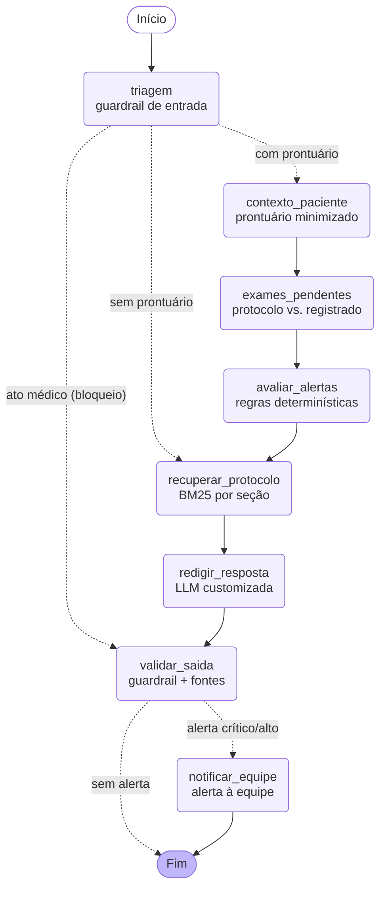

# Arquitetura

## Visão geral

O sistema tem duas trilhas que se encontram no assistente: uma **offline**, que
prepara dados e treina o modelo, e uma **online**, que responde ao médico.

```
OFFLINE (preparação e treino)
  data/raw/ (corpus sintético com PII)
      │
      ├─▶ anonimização (pseudonimização determinística)
      │        │
      │        ├─▶ data/processed/protocolos/   → base de conhecimento (RAG)
      │        └─▶ curadoria (dedup, filtros, gate de PII, exigência de fonte)
      │                 └─▶ data/processed/{train,val}.jsonl
      │                          └─▶ fine-tuning LoRA ─▶ merge ─▶ GGUF
      └─▶ data/structured/prontuarios.db (base estruturada)

ONLINE (atendimento)
  médico ─▶ CLI / API ─▶ fluxo LangGraph ─▶ LLM customizada (llama-server local)
                              │
                              ├── prontuário (SQLite)      ─┐
                              ├── protocolos (BM25)         ├─▶ evidências citadas
                              ├── regras de alerta          ─┘
                              └── guardrails + trilha de auditoria
```

## Camadas do pacote

| Camada | Módulo | Responsabilidade |
|---|---|---|
| Dados | [`data/`](../src/med_assist/data/) | geração sintética, anonimização, curadoria, ingestão do MedQuAD |
| Conhecimento | [`knowledge/`](../src/med_assist/knowledge/) | prontuário estruturado (SQLite) e recuperação de protocolo (BM25) |
| Assistente | [`assistant/`](../src/med_assist/assistant/) | fluxo LangGraph, prompts, ferramentas LangChain, regras de alerta |
| Segurança | [`safety/`](../src/med_assist/safety/) | guardrails de entrada e saída, trilha de auditoria, explicabilidade |
| Treino | [`finetune/`](../src/med_assist/finetune/) | dataset tokenizado, LoRA, merge/GGUF, avaliação |
| Serviço | [`serving/`](../src/med_assist/serving/) | API REST |

A dependência aponta sempre para dentro: `assistant` conhece `knowledge` e
`safety`; `knowledge` não conhece o assistente; `data` e `finetune` não conhecem
nenhum dos dois em tempo de execução. A persona é o único texto compartilhado
entre treino e inferência ([`persona.py`](../src/med_assist/persona.py)) — de
propósito, para que o modelo não seja treinado com um contrato e executado com outro.

## Fluxo de decisão (LangGraph)



O diagrama acima é a versão comentada do grafo real; o desenho gerado
diretamente do código está em [`fluxo-langgraph.mmd`](fluxo-langgraph.mmd) e é
reproduzível com `med-assist graph mermaid`.

### O que cada nó garante

| Nó | Determinístico? | Garantia |
|---|---|---|
| `triagem` | sim | pedido de ato médico não chega ao modelo |
| `contexto_paciente` | sim | só o contexto clínico mínimo é exposto |
| `exames_pendentes` | sim | pendência é diferença de conjuntos, não opinião |
| `avaliar_alertas` | sim | alerta nasce de regra sobre dado estruturado |
| `recuperar_protocolo` | sim | citação com granularidade de seção e score |
| `redigir_resposta` | **não** | único ponto de geração — recebe tudo pronto |
| `validar_saida` | sim | sem PII cadastral, com fonte e com aviso de validação |
| `notificar_equipe` | sim | alerta crítico/alto vira notificação registrada |

Sete dos oito nós são código. O modelo redige; ele não decide o que é verdade
sobre o paciente.

## Decisões e alternativas descartadas

**BM25 em vez de embeddings.** O corpus são 8 protocolos institucionais, com
vocabulário técnico estável e códigos (`PROT-EME-002`) que precisam casar
literalmente. Busca léxica acerta esse caso, responde em milissegundos sem
carregar um modelo de embedding e é auditável — dá para mostrar o score e os
termos que casaram. Um índice vetorial passaria a valer com corpus maior e
consultas mais parafrásticas; a interface `ProtocolRetriever.search` isola essa
troca.

**Fine-tuning para forma, recuperação para conteúdo.** O treino ensina registro,
formato e limites; o conhecimento do caso vem por recuperação, em tempo de
consulta. Protocolo é documento vivo — a versão 6.0 do bundle de sepse vira 6.1 e
o modelo treinado continuaria repetindo a antiga. Trocar o arquivo em
`data/processed/protocolos/` corrige a resposta na hora.

**LoRA em vez de fine-tuning completo.** Treina ~1,75% dos parâmetros, roda em
CPU ou numa T4 gratuita, e o adapter tem poucos MB — versionar, comparar e
reverter fica trivial.

**Guardrails fora do modelo.** Fine-tuning inclina o comportamento; não o
garante. Um pedido de prescrição é barrado por regra antes da chamada ao LLM, o
que elimina a dependência da sorte do decoding e economiza a inferência.
